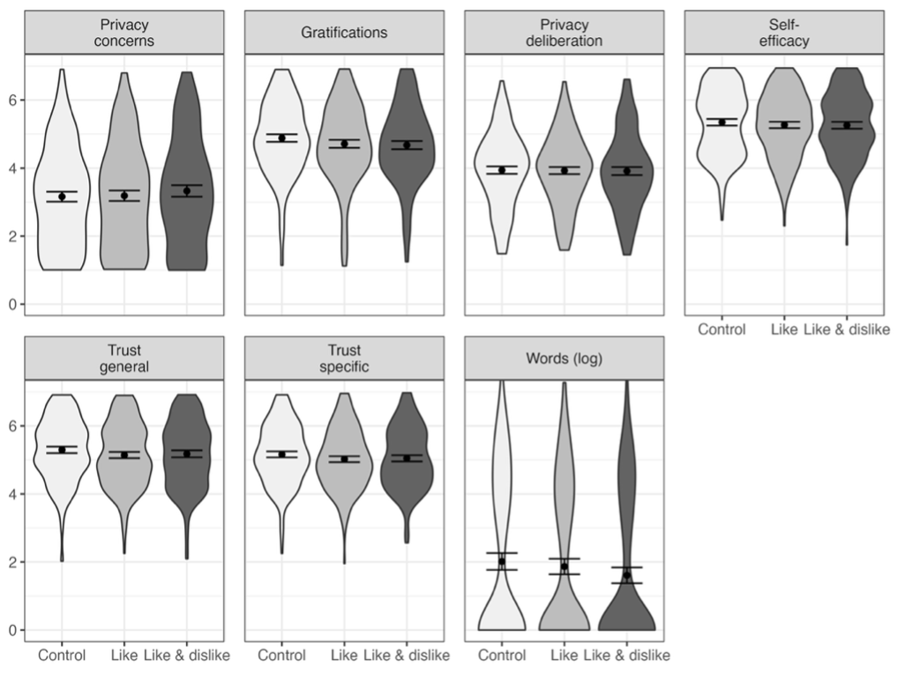

For this manuscript, the hypotheses, sample size, research materials, analyses, and exclusion criteria were preregistered (see [OSF](https://osf.io/a6tzc/overview?view_only=5d0ef9fe5e1745878cd1b19273cdf859)). In some cases, the preregistered approach had to be changed. We present the updated methods, using Bayesian hurdle models, in the main text of this paper.

As preregistered, all hypotheses and research questions were initially tested using structural equation modeling with latent variables. The influence of the three websites was analyzed using contrast coding. Because the assumption of multivariate normality was violated, we estimated the models using robust maximum likelihood [@klinePrinciplesPracticeStructural2016]. As recommended by @klinePrinciplesPracticeStructural2016, we report the model’s RMSEA (90% CI), CFI, and SRMR to assess global fit. To exclude confounding influences, we controlled all variables for age, gender, and education, which have been shown to affect both privacy concerns and online communication [@masurUnderstandingEffectsConceptual2023; @tifferetGenderDifferencesPrivacy2019a]. The preregistered hypotheses were tested with a one-sided significance level of 5%; the research questions were tested with a two-sided 5% significance level using family-wise Bonferroni-Holm correction.

The structural equation model with multiple predictors fit the data okay, $\chi^2$(387) = 934.98, $p$ < .001, CFI = .94, RMSEA = .05, 90% CI [.05, .05], SRMR = .05. With regard to H1, privacy concerns did not significantly predict communication ($\beta$ = -.01, $b$ = -0.01, 95% CI [-0.30, 0.28], $z$ = -0.07, $p$ = .473; one-sided). Regarding H2, results showed that gratifications did not predict communication ($\beta$ = -.02, $b$ = -0.04, 95% CI [-0.19, 0.12], $z$ = -0.45, $p$ = .327; one-sided). RQ1 similarly revealed that privacy deliberation did not predict communication ($\beta$ = -.10, $b$ = -0.16, 95% CI [-0.35, 0.02], $z$ = -1.76, $p$ = .078; two-sided). Regarding H3, however, we found that experiencing self-efficacy predicted communication substantially ($\beta$ = .37, $b$ = 0.77, 95% CI [0.49, 1.05], $z$ = 5.42, $p$ < .001; one-sided). Concerning H4, results showed that trust was not associated with communication ($\beta$ = -.03, $b$ = -0.09, 95% CI [-0.56, 0.38], $z$ = -0.36, $p$ = .358; one-sided).

However, these results should be treated with caution. First, communication was not normally distributed (i.e., zero-inflated and gamma distributed). Although it is possible to analyze non-normal data with structural equation modeling, it is recommended to use analyses that model the variables’ distribution, which can be achieved with Bayesian hurdle models [@mcelreathStatisticalRethinkingBayesian2016]. The Bayesian hurdle models, modeling the outcome as a zero-inflated gamma distribution using default (flat) priors [chains = 4, iterations = 2,000, warm-up = 1,000, @R-brms_a] are reported in the main text. 

Second, in the preregistered analyses several variables were combined that are theoretically and empirically closely related, leading to multicollinearity [@vanhoveCollinearityIsnDisease2021]. We found several signs of multicollinearity among the predictors, evidenced by the large standard errors or “wrong” and reversed signs of predictors [@vanhoveCollinearityIsnDisease2021]. For example, in the bivariate analysis trust had a positive relation with communication, whereas in the multiple regression the effect was negative—which should make us skeptical. In predicting communication, we opted for general trust over specific trust, as it exhibited lower levels of empirical and theoretical overlap with gratifications. The updated analyses provided in the main text show these different results. As a remedy, we adopted a causal modeling perspective, controlling only for confounders---in this case, age, gender, and education---but not for mediators [@rohrerThinkingClearlyCorrelations2018].

[]{#figA1}

```{r}
#| label: distributions-prereg
#| echo: false
#| fig-cap: "Figure A1. Distributions and means with 95% CIs of the model-predicted values for each variable, separated for the three websites. Control: Website without buttons. Like: Website with like buttons. Like & Dislike: Website with like and dislike buttons. Values from pre-registered SEM."


```


Finally, we analyzed the effects of the popularity cues. It was for example expected that websites with like buttons would lead to more communication, more gratifications, more privacy deliberation, and less privacy concerns. The results showed that the popularity cues had no effects on communication and on the privacy calculus variables. For an illustration, see [Figure A1](#figA1).


